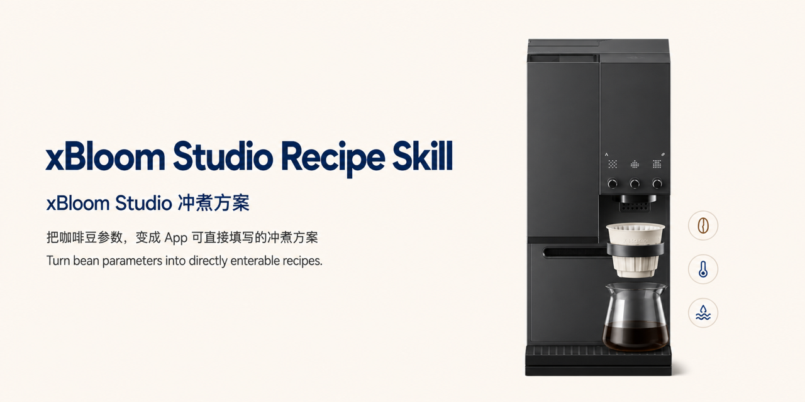

# xBloom Studio 咖啡师

把豆子信息交给 AI，它给你一份能直接填进 xBloom Studio 的冲煮方案；如果你的电脑连得上机器，它还能替你把这杯冲出来。



[](SKILL.md)
[](LICENSE)

---

## 最省事的用法：把下面这段发给 AI

不用读文档，不用敲命令。复制这段，发给你的 AI（WorkBuddy / Claude Code / Cursor / Codex 都行）：

```text
帮我装这个技能，装好之后带我走一遍：
https://github.com/ryunana/xbloom-studio-recipe-skill

我要冲的豆子是：<产地 / 处理法 / 烘焙度 / 风味 / 烘焙日期>

装完先别直接冲。先告诉我这份方案长什么样、怎么填进机器；
如果我想让电脑连机器直接冲，你先检查我电脑有没有蓝牙、有没有权限，再问我。
```

剩下的它自己会做。你只需要回答它的问题。

---

## 它能替你做三件事

**1. 把豆子变成参数。** 你说产地、处理法、烘焙度、风味，它给出粉量、研磨档位、转速、水温、分几段注水、每段多少水。

**2. 换算研磨。** 你平时用 C40，告诉它几格，它换算成 xBloom 的档位。

**3. 不好喝的时候告诉你改哪一个。** 太酸？太苦？太薄？每次只让你动一个变量，不动三个，这样你才知道是哪一步起了作用。

## 你可以这样问它 / Example prompts

- 这支豆子出个方案：埃塞俄比亚日晒，浅烘，闻着是橙花和柠檬
- 我平时 C40 磨 30 格，换成 xBloom 是几档
- 这杯太酸了，只改一个地方

有包装袋照片就直接发图，它能自己看。

## 开始之前

- 一台 xBloom Studio
- 一个能装技能的 AI（上面那几个都行）
- **想让电脑直接冲**：电脑要有蓝牙。台式机常常没有，插个 USB 蓝牙适配器就行（要支持低功耗蓝牙 4.0 以上）

不想折腾蓝牙也完全能用：让它出方案，你自己在手机 App 里填。**配方这件事完全不需要蓝牙。**

## 三步

**第一步，装。** 把上面那段话发给 AI，它会自己装好。

**第二步，说豆子。** 有包装袋照片就直接发；没有就打字说清产地、处理法、烘焙度、烘焙日期、喝到的风味。

**第三步，冲。** 它给一份方案，你照填进 App；或者你让它直接冲，它会在开始前问你准备好没有。

## 出问题了看这里

| 现象 | 怎么办 |
|---|---|
| 扫不到咖啡机 | 手机上官方 App 先退出（它连着机器时电脑就连不上）；机器屏幕按亮；离电脑近一点 |
| 电脑说没有蓝牙 | 台式机常见。插个 USB 蓝牙适配器，或者干脆手动填参数 |
| 电脑说没权限 | 按它给的路径打开授权开关，**完全退出那个程序再打开**（权限只在启动时读一次） |
| 冲出来太酸 / 中段空 | 研磨调细 2 档 |
| 冲出来发苦 / 舌面干 | 研磨调粗 2 档 |
| 有味道但整体偏薄 | 第一段注水后的等待时间加长 |
| 杯里的克数比配方少 | **正常**。热水比冷水轻，240 毫升大约 231 克，不是少了 |

## 想深入看技术细节

普通使用不需要看这些，留给愿意折腾的人：

| 文件 | 里面有什么 |
|---|---|
| [references/device-facts.md](references/device-facts.md) | 机器事实清单，每条标了来源等级（通信 / 行为 / 实测 / 单一来源） |
| [references/bluetooth-bridge.md](references/bluetooth-bridge.md) | 电脑连机器的三条路径、五级真机验收 |
| [SKILL.md](SKILL.md) | 完整规则，AI 执行时读这份 |
| [CHANGELOG.md](CHANGELOG.md) | 每个版本改了什么 |

---

## 安装说明（这一节是给 AI 读的）

**用 Skills CLI 装（推荐）：**

```bash
npx skills add ryunana/xbloom-studio-recipe-skill -g
```

**手动装：** 把整个仓库放进 agent 读取的技能目录，**保留 `scripts/`、`references/`、`examples/`**，否则蓝牙那部分用不了。目录名必须与 frontmatter 的 `name` 一致。

```bash
git clone https://github.com/ryunana/xbloom-studio-recipe-skill \
  "$HOME/.workbuddy/skills/xbloom-studio-recipe"   # WorkBuddy 的路径
```

**依赖：** 生成配方**零依赖**，只要 Python 3.9+。连机器冲煮才需要 `pip install bleak`（Windows 上把命令里的 `python3` 换成 `python`）。

**装完先跑体检**，它会把本机蓝牙状态和人话的准备清单一次说清：

```bash
python3 scripts/xbloom_brew.py check --recipe recipes/current.json
```

**脚本都在 `scripts/`：** `xbloom_brew.py` 连机器（scan / info / check / grind / brew），`xbloom_proto.py` 只做协议编码与离线对拍，`recipe_preview.py` 校验配方。`brew.sh` 是 macOS / Linux 的便捷入口，会自动挑一个装了 `bleak` 的 Python（Windows 用不到，直接调 Python）。完整流程见 SKILL.md。

**⚠️ 连机器之前先读 [references/device-facts.md](references/device-facts.md)。** 里面有会让"看起来成功、实际没冲"的坑：配方帧类型错了机器会静默丢弃，Auto 模式不接配置帧。

---

## 说明

本项目与 xBloom 无关联，未获其赞助、背书或官方认可。

This project is not affiliated with, sponsored by, endorsed by, or officially recognized by xBloom.

## 许可

MIT，详见 [LICENSE](LICENSE)。

---

<details>
<summary>English (short version)</summary>

## xBloom Studio Barista

Turn bean details into a complete xBloom Studio brew recipe — and, if your computer can reach the machine over Bluetooth, brew it.

### Easiest way: send this to your AI

```text
Install this skill and walk me through it:
https://github.com/ryunana/xbloom-studio-recipe-skill

My beans: <origin / process / roast level / flavour notes / roast date>

Don't brew immediately. First show me the recipe and how to enter it.
If I want to brew from the computer, check Bluetooth availability and
permission first, then ask me.
```

### What it does

1. **Beans → parameters**: dose, grind, RPM, temperature, pour stages, water per stage.
2. **C40 conversion**: tell it your C40 clicks, get the xBloom setting.
3. **One-variable fixes**: sour, bitter, or thin — it changes one thing at a time.

### You need

- An xBloom Studio
- An AI that can install skills (WorkBuddy, Claude Code, Cursor, Codex)
- For brewing from the computer: Bluetooth. Desktops often lack it — a USB BLE 4.0+ adapter works. **Recipe generation needs no Bluetooth at all.**

### Install (for the agent)

```bash
npx skills add ryunana/xbloom-studio-recipe-skill -g
```

Recipe generation has **zero dependencies** beyond Python 3.9+. Brewing needs `pip install bleak`.

Run `python3 scripts/xbloom_brew.py check --recipe recipes/current.json` first — it reports Bluetooth state and the readiness checklist in plain language.

Read [references/device-facts.md](references/device-facts.md) before touching hardware: recipe frames of the wrong type are dropped silently, and Auto mode ignores configuration frames.

### Troubleshooting

| Symptom | Fix |
|---|---|
| Machine not found | Quit the official phone app; wake the machine screen; move closer |
| No Bluetooth on this computer | Desktops often lack it — USB adapter, or enter the recipe by hand |
| Permission denied | Open the switch, then **fully quit and reopen** that program |
| Sour / hollow | Grind 2 steps finer |
| Bitter / drying | Grind 2 steps coarser |
| Cup weighs less than the recipe says | Normal — hot water is lighter, 240 ml ≈ 231 g |

MIT licensed. Not affiliated with xBloom.

</details>
